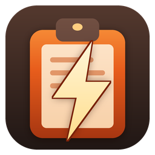
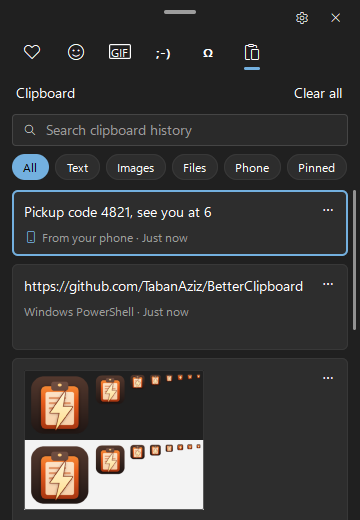
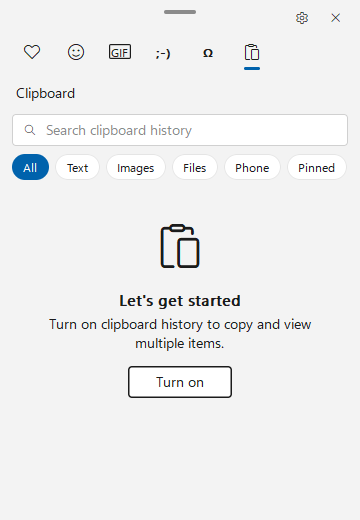
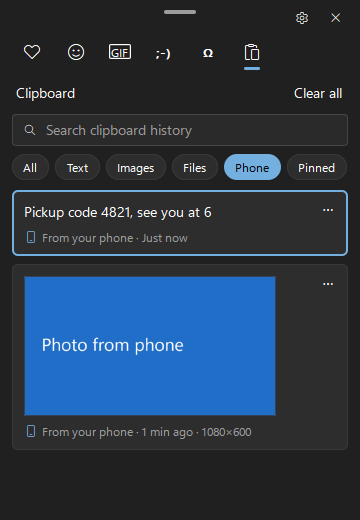
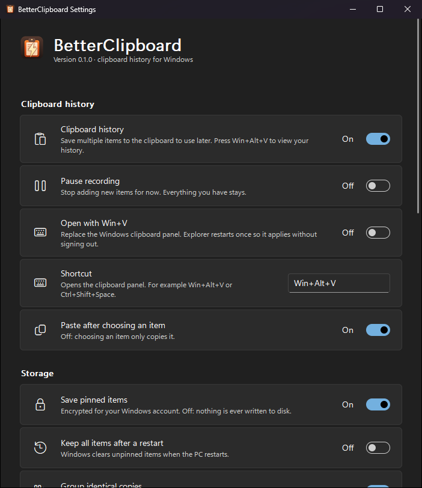

  

<h1 align="center">BetterClipboard</h1>

  <b>The Windows 11 clipboard history, but faster and with the parts that are missing.</b> 
  Screenshots you can save, entries from your phone, search, and a 1&nbsp;MB native Rust app that opens in about 20&nbsp;ms.

  <a href="#install">Install</a> ·
  <a href="#what-you-get">Features</a> ·
  <a href="#the-numbers">Numbers</a> ·
  <a href="#build-from-source">Build</a> ·
  <a href="docs/limitations.md">Limitations</a>

  
  &nbsp;
  

Part of the Better series, next to [Better Task Manager](https://github.com/TabanAziz/BetterTaskManager).

## Why

Win+V is handy until you need it for more than the last line of text. A screenshot you snipped ten minutes ago is in there, but you cannot save it. Something you copied on your phone shows up, but nothing tells you which entry it was. There is no search, and Windows documents a limit of 4 MB per entry, so big pictures can drop out of the history without a word.

BetterClipboard keeps the panel people already know, the same layout and the same click paths, and adds what is missing.

## What you get

| | |
| --- | --- |
| **Familiar panel** | Grip, tab row, "Clipboard" with "Clear all", entry cards with "See more" (...) for pin and delete, "Let's get started / Turn on" when history is off. Light and dark like your Windows theme. |
| **Paste where you were** | Pick an entry with the mouse or arrows and Enter: it goes into the app you came from. Shift+Enter pastes plain text, Ctrl+Enter only copies. |
| **Pictures** | Previews for screenshots and copied images, "Save image as" (PNG or BMP, Ctrl+S) and "Open image". Full-screen 4K screenshots are kept. |
| **Your phone** | With Phone Link's cross-device copy and paste, what you copy on your Android phone lands on the PC clipboard. BetterClipboard marks those entries with a phone icon ("From your phone") and has a Phone filter. |
| **Find things** | Type to search, filters for text, images, files, phone and pinned. Identical copies are grouped. |
| **More than text** | Text, links, HTML and RTF keep their formatting; files copied in Explorer can be pasted again. |
| **Keep what matters** | Pinned entries survive restarts, encrypted with DPAPI for your Windows account. Optional: keep the whole history, longer history than 25 entries, automatic removal after N days, snippets you type yourself. |
| **Privacy** | Copies that password managers mark as private are never recorded. Pause recording from the tray, exclude apps, save nothing to disk at all if you want. No network, no telemetry. |

  
  
  

## The numbers

| BetterClipboard 0.1.0 | |
| --- | --- |
| Shortcut until the painted panel, 25 entries | **19 ms** median, 33 ms p95 |
| Same with 1 000 entries | **18 ms** median, 36 ms p95 |
| Keystroke in search until painted, 10 000 entries | **14 ms** median, 14 ms p95 |
| Start until ready (warm) | **28 ms** median |
| Size of the program | **1 MB**, no runtime, no administrator rights |

Measured on an Intel Core i7-11800H laptop with Windows 11 25H2 at 100% scaling. Panel times include waiting for the compositor to show the frame. Method, raw data and idle CPU in <a href="docs/benchmarks.md">docs/benchmarks.md</a>. Your numbers will differ.

## Install

Download `BetterClipboard.exe` from the releases page, or build it (below), then run:

    BetterClipboard.exe --install

This copies the program to `%LOCALAPPDATA%\Programs\BetterClipboard`, adds it to the Start menu and to "Installed apps", and starts it at sign-in. No administrator rights needed. Remove it from Settings > Apps, or with `BetterClipboard.exe --uninstall`.

You can also just run the exe without installing.

## Use

- **Win+Alt+V** opens the history (change it in Settings). Clicking the tray icon works too.
- Want Win+V to open BetterClipboard instead of the Windows panel? Run `BetterClipboard.exe --use-win-v` or use Settings > "Use Win+V...". It switches off Windows' own Win+V for your account and restarts Explorer so it applies right away. `--windows-win-v`, the same button or uninstalling gives Win+V back.
- Right-click an entry or press the Menu key for everything else: paste as plain text, copy only, pin, delete, save or open an image, show a file in Explorer.
- To get your phone's clipboard: in Phone Link, turn on "Cross-device copy and paste" (Settings > Features). It works with supported Android phones.

Command line: `--show`, `--settings`, `--snippet`, `--quit`, `--background`, `--install`, `--uninstall`.

## System requirements

Windows 11 (built and tested on 25H2, build 26200), x64. Windows 10 should work but is not tested.

## Build from source

Rust stable with the MSVC toolchain:

    cargo build --release
    powershell -File tools\check.ps1

The program ends up in `target\release\BetterClipboard.exe`. `tools\release.ps1` builds the portable zip with checksums. Tests that use the real clipboard: see [CONTRIBUTING.md](CONTRIBUTING.md).

## Known limitations

The short version: Win+V cannot be taken over without signing out, Windows' own history and its cloud sync are not readable by other apps, apps running as administrator cannot be pasted into, the emoji/GIF tabs open the Windows emoji panel, and screen reader support in the panel is basic. Phone entries are recognised by the Phone Link process and were tested with a simulated sender, not a real phone. Everything is listed in [docs/limitations.md](docs/limitations.md), and the feature-by-feature comparison with Windows is in [docs/parity-matrix.csv](docs/parity-matrix.csv).

## More

- [Architecture](docs/architecture.md)
- [Test plan and results](docs/test-plan.md)
- [Benchmarks](docs/benchmarks.md)

## License

MIT, see [LICENSE](LICENSE). Third-party crates are listed in [THIRD-PARTY-LICENSES](THIRD-PARTY-LICENSES).
